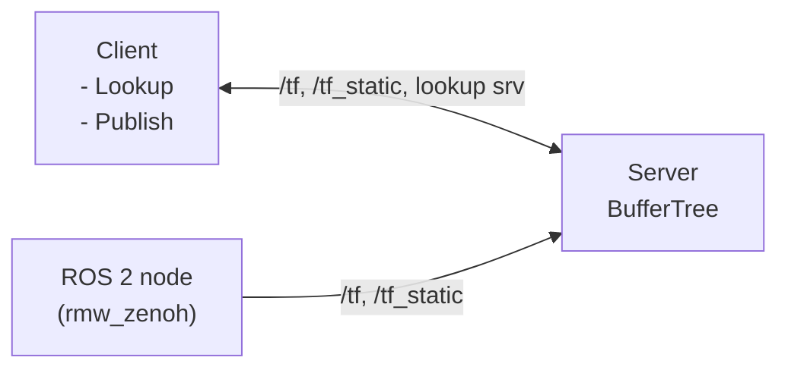
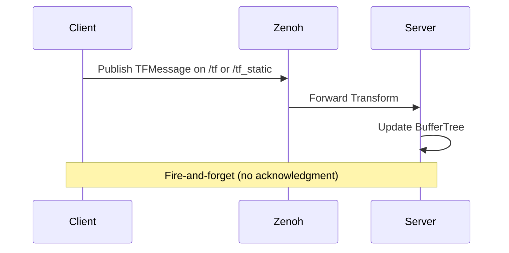
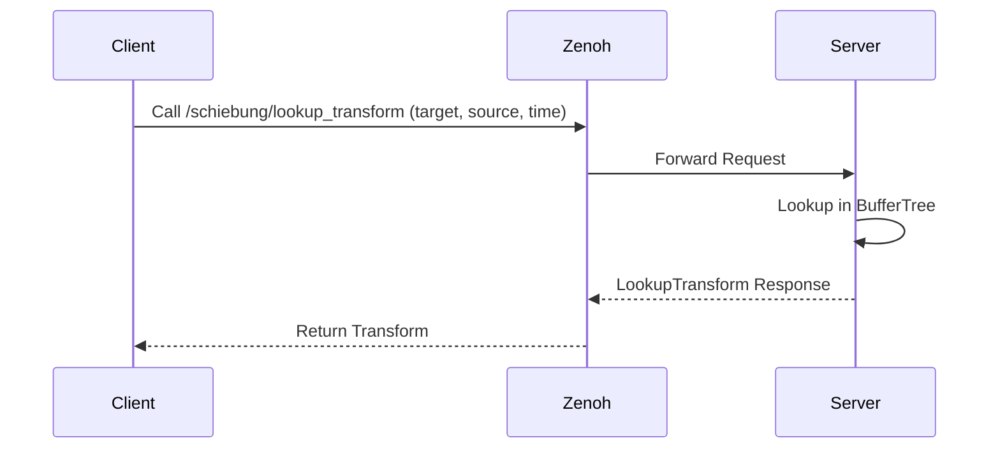

# Schiebung Comms

Client-Server communication for Schiebung transforms speaking the standard **ROS 2 wire format over [Zenoh](https://zenoh.io/)** (compatible with [`rmw_zenoh`](https://github.com/ros2/rmw_zenoh)). No ROS installation is required — but if a ROS 2 system running `rmw_zenoh` is present, schiebung integrates with it natively: the server ingests the live `/tf` graph with zero client code, and ROS tooling sees schiebung nodes in the graph.

## Overview

The comms package provides a client-server architecture for sharing transform data between processes:

- The server subscribes to the standard `/tf` and `/tf_static` topics (`tf2_msgs/TFMessage`) and feeds every transform into its `BufferTree`.
- Static transforms use transient-local durability (like `tf2_ros::StaticTransformBroadcaster`), so a late-starting server still receives them.
- Lookups are served via the custom `schiebung_msgs/LookupTransform` service on `/schiebung/lookup_transform` (a zero time means "latest available", tf2 semantics).
- The full buffer content is available on demand via the `schiebung_msgs/GetTransforms` service on `/schiebung/get_transforms`: it returns the latest sample per edge, split into a dynamic (`/tf`-style) and a static (`/tf_static`-style) `TFMessage`.

Messages are CDR-encoded ROS 2 messages via [hiroz](https://github.com/ZettaScaleLabs/hiroz) (formerly `ros-z`), ZettaScale's pure-Rust ROS 2 stack that speaks the `rmw_zenoh` wire format directly. The message definitions are vendored byte-exact from ROS 2 Jazzy in `comms/ros_msgs/` and compiled by `hiroz-codegen` in `build.rs`, so the RIHS01 type hashes match a real ROS 2 system (Jazzy or newer; Humble uses placeholder hashes and is not supported).

Every endpoint sets its QoS explicitly to match `tf2_ros`: `/tf` is reliable/volatile/keep-last-100, `/tf_static` is reliable/**transient-local**/keep-last-1. QoS mismatches do not raise errors — endpoints simply fail to match and messages are dropped — so these profiles are covered by the integration tests.

## Architecture



### Transform Update Flow



### Transform Request Flow



## Usage

### Client Example

```rust
use comms::TransformClient;
use schiebung::types::{StampedIsometry, TransformType};

#[tokio::main]
async fn main() {
    let client = TransformClient::new().await.unwrap();

    // Publish a transform
    let transform = StampedIsometry::new([0.0, 0.0, 1.0], [0.0, 0.0, 0.0, 1.0], 0);
    client
        .send_transform("base", "sensor", transform, TransformType::Static)
        .await
        .unwrap();

    // Query a transform (time 0 = latest available)
    let result = client.request_transform("base", "sensor", 0).await.unwrap();

    // Fetch the server's full buffer content (latest sample per edge)
    let all = client.request_all_transforms().await.unwrap();
}
```

### Networking

By default both ends run as zenoh peers with UDP multicast discovery. On networks where multicast is blocked (CI, many corporate networks), pin explicit endpoints — either in code via `ZenohConfig`, or via environment variables read by `ZenohConfig::from_env()` (used by the `server` binary and the example):

```sh
# Server
SCHIEBUNG_LISTEN=tcp/127.0.0.1:7447 SCHIEBUNG_MULTICAST=false cargo run -p comms --bin server
# Client
SCHIEBUNG_CONNECT=tcp/127.0.0.1:7447 SCHIEBUNG_MULTICAST=false cargo run -p comms --example publish_transforms
```

### ROS 2 interop

An automated end-to-end interop test against a real ROS 2 Jazzy + `rmw_zenoh` system (in Docker) is available:

```sh
./comms/docker/test_ros_interop.sh
```

It verifies both directions (ROS → schiebung via `/tf_static` + lookup service, schiebung → ROS via `/tf`) and that the schiebung nodes appear in the ROS graph. See `comms/docker/README.md`.

Manually, on a machine with ROS 2 (Jazzy or newer) using `rmw_zenoh`:

```sh
# 1. Start the rmw_zenoh router
ros2 run rmw_zenoh_cpp rmw_zenohd

# 2. Start the schiebung server connected to the router
SCHIEBUNG_CONNECT=tcp/127.0.0.1:7447 SCHIEBUNG_MULTICAST=false cargo run -p comms --bin server

# 3. Publish transforms from ROS -- schiebung ingests them
ros2 run tf2_ros static_transform_publisher --x 1 --frame-id world --child-frame-id base
```

`ros2 node list` shows the schiebung nodes, and `ros2 topic info -v /tf_static` should show matching type hashes for the ROS and schiebung endpoints. `ROS_DOMAIN_ID` is honored via `ZenohConfig::from_env()` / `ZenohConfig::domain_id`.
